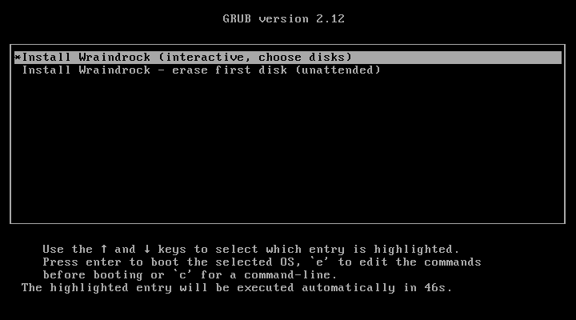
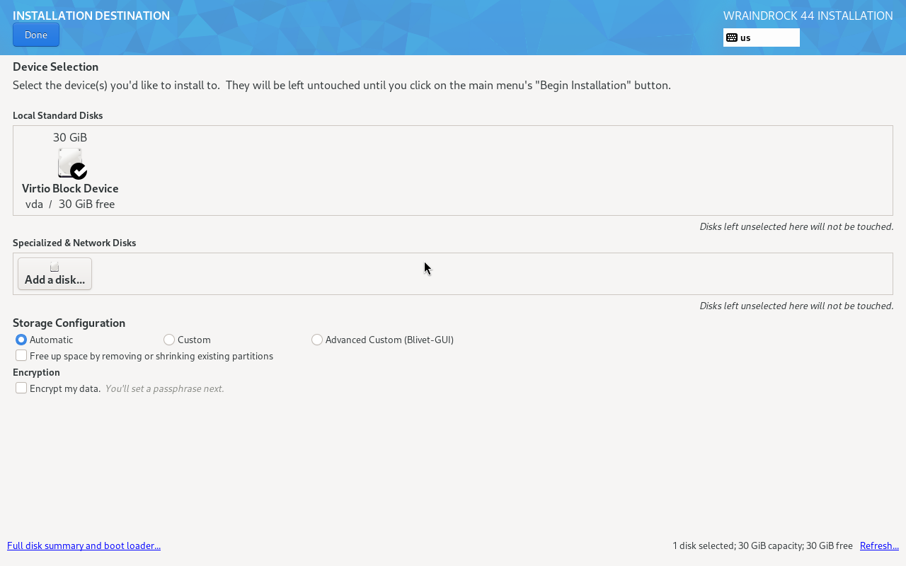
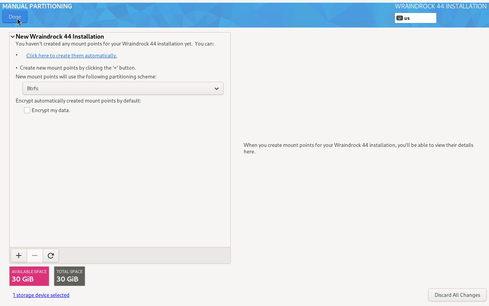
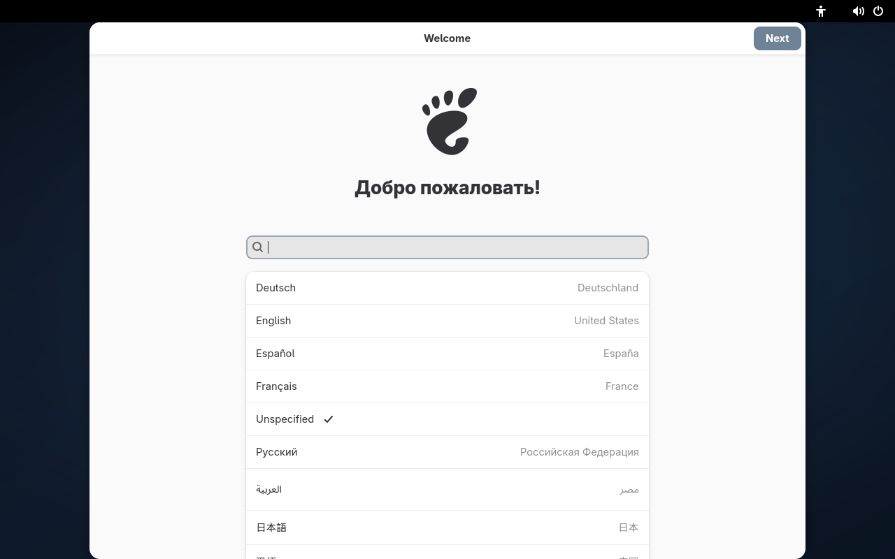

# Wraindrock

A personal, out-of-the-box remix of **Bluefin DX**, delivered as a bootc system
image. Not an independent distribution and not a Fedora derivative: the desktop,
kernel, drivers, uBlue tooling and update plumbing are upstream; this repository
owns the identity, the presentation and a short list of personal defaults.

[](https://github.com/Wraindrock/wraindrock-linux/actions/workflows/build.yml)

## What differs from Bluefin DX

- `NAME` and `PRETTY_NAME` say **Wraindrock**; `ID`, `ID_LIKE`, `CPE_NAME` and
  the version fields stay upstream's so uBlue tooling keeps working.
- The GDM logo, a 4K dark wallpaper, a Plymouth boot splash and an opt-in GRUB
  theme replace upstream's presentation.
- A fresh install seeds the hostname to `wraindrock`.

Everything else matches Bluefin DX package for package, except the three
software packages listed below. `/usr/share/wraindrock/delta.json` records every
difference, and CI fails the build if the image carries anything that is not in
that manifest.

## Software

The first boot installs ten Flatpaks from Flathub (needs the network):

| Bluefin DX | Wraindrock |
| --- | --- |
| Podman Desktop, GNOME Builder, DevToolbox, Clapgrep, Embellish, Tavern | Zen Browser, WeChat, Rnote, Gear Lever |

**Zen Browser is the default browser** for links and HTML; Firefox stays
installed and selectable. Three programs have no Flatpak, so their upstream
GitHub RPMs are baked into the image at pinned versions: Clash Verge Rev
2.5.8, Rayburst 4.0.1 and sing-box (SFL) 1.14.3. They update with the image;
use `rpm-ostree override replace` for a single package before then. Bluefin's
other 36 Flatpaks stay one command away: `ujust install-system-flatpaks`.

## Screenshots

Real QEMU frames from CI runs of the published ISO.

| Boot menu | Disk layout | Manual partitioning |
| --- | --- | --- |
|  |  |  |

| GDM login | First boot |
| --- | --- |
|  |  |

The first menu entry installs interactively: choose the disk, the layout
(Automatic, Custom or Blivet-GUI) and the user. Language is picked at GNOME
Initial Setup on first boot. The second entry erases the first disk without
asking.

## Install

Two supported paths.

### 1. Pull the image (ghcr.io)

On an existing Bluefin DX 44 system:

```bash
sudo bootc switch ghcr.io/wraindrock/wraindrock-linux:44
sudo systemctl reboot
```

The switch only adds a boot deployment; `/home`, flatpaks and containers stay
put. Read [docs/install.md](docs/install.md) for preflight checks and
[docs/rollback.md](docs/rollback.md) for the way back.

### 2. Download the ISO

The ISO is built from the same image by `.github/workflows/disk.yml` and
published as an immutable OCI artifact set on GHCR:

```bash
oras pull ghcr.io/wraindrock/wraindrock-linux-disk:<version>
sha256sum -c SHA256SUMS
sudo dd if=install.iso of=/dev/sdX bs=8M status=progress oflag=direct conv=fsync
```

The boot menu offers two entries. The default, **Install Wraindrock
(interactive, choose disks)**, opens Anaconda's hub so you pick the disk,
partitioning and user account yourself; its kickstart only tells Anaconda where
the image payload is. The second, **Install Wraindrock - erase first disk
(unattended)**, clears the first disk without asking — use that one only on a
scratch machine, with data disks detached, or in a VM.

> The ISO is larger than 4 GB, so a FAT32 USB stick will not work — use an 8 GB
> or larger exFAT stick, or write it directly with `dd`.

## Verify

```bash
cat /usr/lib/os-release              # NAME="Wraindrock", ID=bluefin
cat /usr/share/wraindrock/delta.json # every intended difference
hostnamectl                          # wraindrock
flatpak list --system                # ten preinstalled apps after first boot
rpm -q clash-verge rayburst sing-box # the three baked packages
cosign verify \
  --certificate-identity-regexp '^https://github.com/Wraindrock/wraindrock-linux/' \
  --certificate-oidc-issuer https://token.actions.githubusercontent.com \
  ghcr.io/wraindrock/wraindrock-linux:44
```

## Tags

| Tag | Meaning | Mutable |
| --- | --- | --- |
| `44` | Bluefin 44 channel; what `bootc switch ...:44` follows | yes |
| `latest` | Alias of the newest channel | yes |
| `previous` | The channel image `44` pointed at before the last release | yes |
| `44.<UTC timestamp>.<run>` | Artifact of record for one build | **never** |

Install the channel tag; quote the immutable tag when you need to say exactly
which build you ran. Updates: `sudo bootc update && sudo systemctl reboot`.

## Development

- Design, invariants and non-goals: [docs/architecture.md](docs/architecture.md)
- Install, verification, troubleshooting: [docs/install.md](docs/install.md)
- Rollback and escape hatches: [docs/rollback.md](docs/rollback.md)
- Roadmap: [docs/roadmap.md](docs/roadmap.md)
- Build, test and patch rules: [CONTRIBUTING.md](CONTRIBUTING.md)

## License

MIT for this repository's own files. Bluefin, Universal Blue, Fedora, GNOME and
every inherited component remain their upstream projects' work under their own
licenses.
